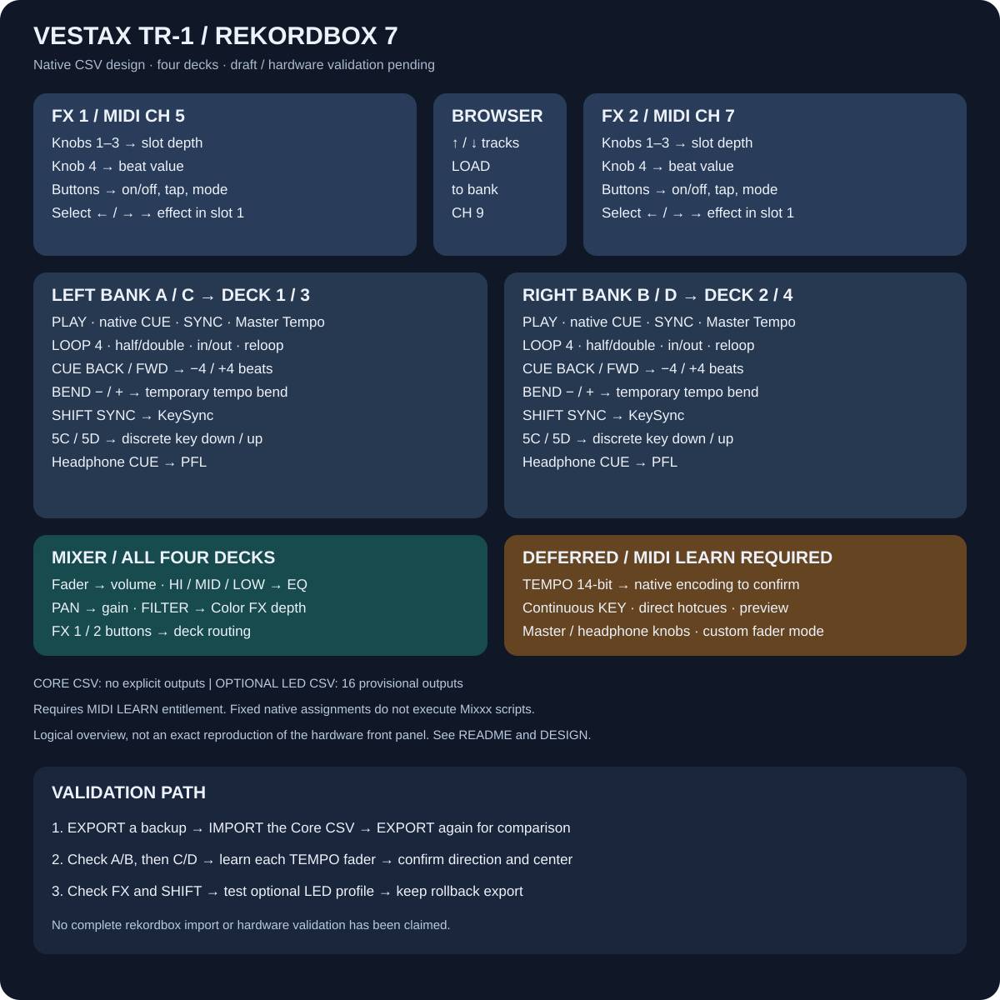

# Vestax TR-1 für rekordbox 7

**Mapping-Design mit zwei nativen CSV-Entwürfen. Import und vollständiger Hardwaretest sind noch offen.**

[English](README.md) · [Technisches Design](DESIGN.md)

Die Erweiterung enthält 61 Funktionszeilen mit **136 eindeutigen MIDI-Eingängen** für vier Decks: Transport, Mixer, Loop-Steuerung, Beatjump, Tempo-Bend, diskrete Tonhöhenfunktionen, FX und Browser. Das bestehende Mixxx-Mapping bleibt als eigene Variante erhalten.

## Voraussetzungen

- rekordbox 7 im **PERFORMANCE-Modus**, TR-1 eingeschaltet und per USB angeschlossen.
- Für MIDI LEARN laut [Hersteller-FAQ](https://rekordbox.com/en/support/faq/rekordbox7/) ein passender Tarif (derzeit Core oder höher) oder ein geeignetes angeschlossenes Hardware-Unlock-Gerät. Der TR-1 selbst steht nicht auf dieser Unlock-Liste.
- Ein separat in rekordbox eingerichteter Audioausgang und gegebenenfalls Kopfhörerausgang.

Das Mapping schaltet keine kostenpflichtigen Funktionen frei. Es ist kein Treiber und benötigt für den Import weder Python noch das Mixxx-JavaScript.

## Einrichtung

1. Repository herunterladen und ZIP entpacken.
2. In rekordbox PERFORMANCE und dann **MIDI** öffnen. Als Gerät **TR-1** auswählen.
3. Zuerst die bestehende TR-1-Belegung mit **EXPORT** sichern. **IMPORT ersetzt die aktuelle Belegung dieses Geräts.**
4. `Vestax-TR-1-rekordbox7-core.midi.csv` importieren. Prüfen, ob die Funktionsliste ohne Fehler geladen wird. Unbekannte Funktionen gegebenenfalls über ADD/LEARN anlegen und anschließend erneut exportieren.
5. Vier-Deck-Ansicht wählen und A/B, danach C/D mit Lautstärke, EQ, Gain, PLAY, CUE und Kopfhörer-CUE testen. FILTER als Color FX auswählen.
6. Die FX-Sektionen testen: Regler 1–3 steuern die jeweiligen Effekt-Slots; Regler 4 den Beat-Wert. Die Auswahltasten wechseln den Effekt in Slot 1.
7. Erst nach diesem Test bei Bedarf `Vestax-TR-1-rekordbox7-leds-experimental.midi.csv` importieren. Diese Alternative ergänzt 16 vorläufige LED-Ausgänge für PLAY, Master Tempo/KEY, PFL und Loop. Sie ersetzt das Core-Profil.
8. Bei Problemen die vorher gesicherte CSV wieder importieren.

Die Funktionsnamen und das 15-spaltige CSV-Format wurden mit den Herstellerdefinitionen der lokal installierten **rekordbox-Version 7.2.19.0342** abgeglichen. Das ist noch keine Bestätigung, dass rekordbox jede Funktion für den TR-1 akzeptiert.

## Belegung gegenüber Mixxx

| TR-1 | rekordbox-Entwurf |
| --- | --- |
| Deckwahlschalter | A/B/C/D → Deck 1/2/3/4 |
| Fader, HI/MID/LOW | Lautstärke und 3-Band-EQ |
| PAN | Gain |
| FILTER | Color-FX-Parameter des jeweiligen Decks |
| PLAY / SET CUE | Native Play/Pause- und Cue-Funktionen |
| SYNC / KEY | Sync / Master Tempo |
| LOOP | 4-Beat-Loop |
| CUE BACK / FWD | −4 / +4 Beats |
| BEND − / + | Momentanes Tempo-Bending |
| SHIFT + SYNC | KeySync; kein zusätzlicher Fader-Modus |
| Shift-Adressen 5C / 5D | Tonhöhe schrittweise abwärts / aufwärts |
| FX-Regler 1–3 | Effektparameter der Slots 1–3 |
| FX-Regler 4 | Effekt-Beat-Wert, nicht Dry/Wet |
| FX-Taste 4 | Effekt-Tap-Tempo |
| Browser vor/zurück + Load | Trackauswahl und Laden in das jeweilige Deck |

Die eigenen Mixxx-Scripts für Cue-Latch, Pause/Play-abhängiges Bending und den zusätzlichen Fader-Modus laufen nicht in diesen festen CSV-Zuordnungen.

## Noch offen: TEMPO und KEY-Drehregler

**Die TEMPO-Fader sind in den CSV-Dateien noch nicht zugeordnet.** Sie senden hochauflösende Pitch-Bend-Daten auf E9/EA/EB/EC. Die für generische Geräte gültige CSV-Codierung und Richtung muss rekordbox selbst beim Lernen bestätigen.

Pro Deck die Tempo-Slider-Funktion über ADD anlegen, wenn möglich den Reglertyp mit **16384 Schritten** wählen, LEARN einschalten und den TEMPO-Fader vollständig bewegen. Danach EXPORT nutzen und den Datensatz sowie Mitte und Richtung prüfen. Akzeptiert rekordbox die Pitch-Bend-Signale nicht, ist eine separate Übersetzung nötig; diese Erweiterung enthält dafür noch keine Bridge.

Auch der kontinuierliche KEY-Regler auf E0/E1/E2/E3 ist zurückgestellt. Ebenso bleiben direkte Hotcues, Preview-Player und Master-/Kopfhörer-Pegelregler bis zur Bestätigung ihrer nativen Funktionen offen. Es werden dafür keine scheinbar fertigen Zuordnungen erfunden.

## Tests und Status

`python3 rekordbox/test_rekordbox.py` prüft Struktur, Eindeutigkeit, Deck-Bänke, bekannte Hardwareadressen und reproduzierbare Generierung. Die Herstellerdefinitionen wurden nur lokal gelesen und werden nicht mitveröffentlicht. Die aktuelle Live-Belegung in rekordbox wurde nicht verändert.

Die nächsten praktischen Schritte sind: Core-CSV importieren, wieder exportieren und vergleichen; A/B/C/D prüfen; TEMPO lernen; danach erst FX, SHIFT und LED-Rückmeldungen bestätigen. Siehe [MIDI-LEARN-Handbuch](https://cdn.rekordbox.com/files/20241203210623/rekordbox7.0.5_midi_learn_operation_guide_EN.pdf).
