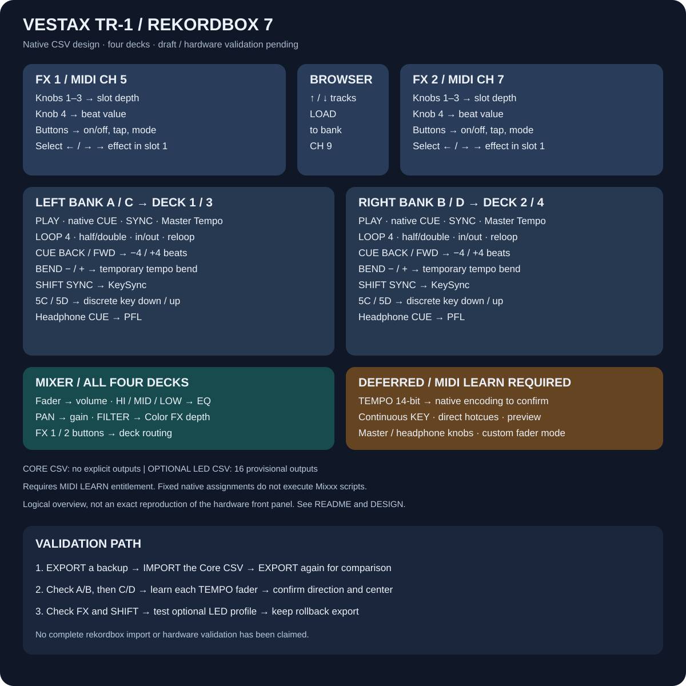

# Vestax TR-1 → rekordbox 7

**Mapping design and native CSV drafts — not yet import- or hardware-validated.**

[Deutsch](README.de.md) · [Design and porting decisions](DESIGN.md) · [Layout](layout.svg)



This adds a rekordbox alternative alongside the existing Mixxx mapping. The TR-1's A/C and B/D banks retain their four-deck roles. The native draft contains **61 function rows / 136 unique MIDI inputs**: transport, mixer, loop controls, four-beat jumps, temporary pitch bends, native key functions, FX units 1/2, deck loading and browser up/down.

## Files

| File | Purpose |
| --- | --- |
| `Vestax-TR-1-rekordbox7-core.midi.csv` | Start here. Native fixed assignments; no explicit MIDI outputs. |
| `Vestax-TR-1-rekordbox7-leds-experimental.midi.csv` | Alternative profile with 16 provisional feedback assignments. Import instead of the core profile, not alongside it. |
| `generate.py` | Rebuild both profiles without third-party libraries. |
| `test_rekordbox.py` | Check CSV structure, address uniqueness, measured deck/mixer addresses and reproducibility. |

No vendor CSV file or unmodified source mapping is redistributed. Function identifiers and the 15-column CSV layout were checked against factory definitions installed with **rekordbox 7.2.19.0342**. Presence in those definitions does not prove that every function is available for third-party MIDI LEARN or that this file imports successfully.

## Requirements

Use **PERFORMANCE** mode with the TR-1 connected and powered on. MIDI LEARN requires a qualifying plan (currently Core or higher) or an appropriate connected Hardware Unlock device. The TR-1 is not listed as a rekordbox 7 Hardware Unlock device. This mapping cannot unlock paid features. Check the [current official FAQ](https://rekordbox.com/en/support/faq/rekordbox7/) before purchasing anything.

## Setup

1. Download/extract the repository. Keep the Mixxx files installed for Mixxx only; rekordbox uses the CSV files in this folder.
2. Connect and power on the TR-1. Launch rekordbox and select PERFORMANCE mode.
3. Open the **MIDI** window and choose **TR-1** from the device list.
4. **EXPORT your existing TR-1 mapping first.** IMPORT overwrites the selected device's current mapping; keep the export somewhere separate.
5. IMPORT `Vestax-TR-1-rekordbox7-core.midi.csv`. Confirm that the table populates. If it rejects a function, use ADD/LEARN to recreate that assignment and record the exported row; do not treat this draft as validated.
6. Choose a four-deck view. Configure your main/headphone audio device in rekordbox separately.
7. Select the FILTER Color FX and check deck volume/EQ/gain, then PLAY/CUE/PFL. Test A/B first and C/D next.
8. Test FX in the appropriate unit mode. The fourth FX knob controls the **beat value**, not Mixxx's Dry/Wet. EFFECT SELECT targets **slot 1**, not an entire effect-chain preset.
9. If core inputs work, back up again and optionally import the experimental LED profile. Test its PLAY, KEY/master-tempo, PFL and loop indicators independently. Return to the core profile if feedback is wrong.

The official [MIDI LEARN guide](https://cdn.rekordbox.com/files/20241203210623/rekordbox7.0.5_midi_learn_operation_guide_EN.pdf) explains ADD, LEARN, IMPORT, EXPORT and 7-/14-bit knob types. This project does not copy files into the application's factory-mapping folder or alter your current live mapping.

## Tempo and continuous KEY: deliberately unfinished

The TR-1 sends tempo as Pitch Bend on **E9/EA/EB/EC** and continuous KEY on **E0/E1/E2/E3**. Those hardware messages were captured previously. Their correct generic-device rekordbox CSV encoding and direction have not been confirmed, so **neither control is assigned in these CSV drafts**.

For each tempo bank, use ADD → the tempo-slider function in the MIDI window, choose a **16384-step knob/slider** type where offered, enable LEARN and move that bank's TEMPO fader through its range. EXPORT afterward and check the resulting row, fader center and direction. If rekordbox cannot learn the Pitch Bend messages, keep tempo on screen; a separately designed MIDI translation layer would be needed. No such bridge is included or claimed to work here.

There is no verified continuous KEY equivalent in this draft. SHIFT key-down/key-up buttons provide discrete native key changes instead. Do not manually invent `E900` or similar CSV codes from the MIDI status alone.

## Differences from Mixxx

- CUE uses rekordbox's native behavior. The custom Mixxx cue/PLAY latch, automatic Quantize changes and long-press callbacks are not executed.
- SHIFT+SYNC is native **KeySync**, not the extra-deck volume-fader mode.
- BEND is native momentary bending; it does not change to beatjump when paused.
- Shifted addresses `5C/5D` perform discrete key down/up instead of changing beatjump size.
- Master/headphone level knobs, preview-player controls, direct hotcues, continuous KEY and tempo remain deferred; they are not silently assigned guessed function names.
- No software SHIFT modifier or synthetic Note Off route is added. The design relies on the distinct messages produced by the TR-1 hardware banks/SHIFT functions from the supplied mapping.

See [DESIGN.md](DESIGN.md) for the detailed control table and validation checklist.

## Verification

```sh
python3 rekordbox/generate.py
python3 rekordbox/test_rekordbox.py
```

Optional local check against an installed `MidiMappings` directory:

```sh
python3 rekordbox/test_rekordbox.py --vendor-dir '/path/to/rekordbox/MidiMappings'
```

Automated checks cover syntax and address consistency, not the application importer, feature entitlement, pickup behavior, FX routing semantics or physical LEDs. Import/export round-trip and hardware checks remain open. To undo an import, select TR-1 and IMPORT your previous export.
